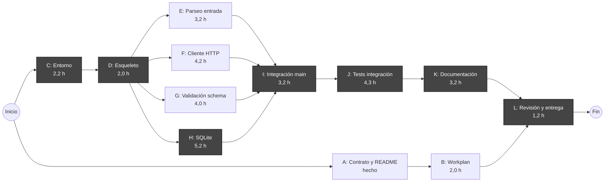

# Workplan: api-client-stackoverflow

**Materia:** Redes de las Computadoras II
**Versión:** 1.1 (24/11/2026)
**Responsable:** Nicolás Dinolfo

Este documento complementa a [`contrato-proyecto.md`](contrato-proyecto.md). Define qué se implementa, cuándo y en cuánto tiempo. Puede ajustarse durante el proyecto; cada cambio queda registrado en la sección 6 y en los commits correspondientes.

---

## 1. Supuestos

- Una sola persona desarrolla el proyecto.
- Dedicación estimada: **2 horas por día**, desde el 25/11 hasta el 11/12/2026.
- Entorno de desarrollo: Linux.
- Meta de fecha: llegar a la mesa de examen del 15/12/2026.

## 2. Actividades

| ID | Actividad | Entregable | Predecesoras | Duración (h) |
|---|---|---|---|---|
| A | Contrato formal y README ampliado | `contrato-proyecto.md`, `README.md` | — | hecho |
| B | Workplan con PERT | `workplan.md` | A | 2,0 |
| C | Preparar entorno Linux (gcc, make, libcurl, cJSON, SQLite) | Entorno que compila un "hola mundo" con las 3 librerías | — | 2,2 |
| D | Esqueleto: estructura de carpetas, `Makefile`, `db/schema.sql` | Proyecto que compila vacío | C | 2,0 |
| E | Parseo de entrada (ID o URL) y tests unitarios | `input.c` + tests | D | 3,2 |
| F | Cliente HTTPS con libcurl (gzip, códigos HTTP) | `http.c` | D | 4,2 |
| G | Validación del schema con cJSON | `schema.c` + fixtures | D | 4,0 |
| H | Persistencia SQLite: `assets`, `assets_history`, transacción | `db.c` | D | 5,2 |
| I | Integración en `main.c`: flujo completo y códigos de salida | `so-worker` funcional | E, F, G, H | 3,2 |
| J | Tests de integración (offline con `--from-file`) | `tests/run_tests.sh` | I | 4,3 |
| K | Documentación final y evidencias | `Documentacion/` completa | J | 3,2 |
| L | Revisión final y entrega | Repositorio listo | B, K | 1,2 |

## 3. Diagrama PERT (red de actividades)

Cada nodo muestra la actividad y su duración en horas (las mismas de la tabla de la sección 2). Los nodos oscuros forman el camino crítico.

**Camino crítico:** C → D → H → I → J → K → L, con una duración esperada de **≈ 21,2 horas**.

Como el desarrollo lo hace una sola persona, las actividades E, F, G y H no pueden hacerse en paralelo en la práctica. Por eso el calendario de la sección 4 se arma sumando el esfuerzo pendiente (≈ 32,5 h, ya descontado el trabajo hecho) a un ritmo de 2 h por día.

## 4. Hitos y fechas

| Hito | Fecha objetivo | Actividades | Criterio de cumplimiento |
|---|---|---|---|
| H1: Base del proyecto | 27/11/2026 | C, D | El entorno compila con las 3 librerías y el proyecto compila vacío |
| H2: Entrada y red | 30/11/2026 | E, F | Se parsea ID/URL y se obtiene el JSON real de la API |
| H3: Schema validado | 02/12/2026 | G | Se detectan respuestas inválidas con el código de salida 3 |
| H4: Persistencia | 05/12/2026 | H | Alta, actualización con historial y "sin cambios" funcionan |
| H5: Flujo completo | 06/12/2026 | I | `./so-worker <id>` funciona de punta a punta |
| H6: Tests | 09/12/2026 | J | `make test` pasa todos los casos |
| H7: Entrega | 11/12/2026 | K, L | Documentación y evidencias completas; repo listo |

Los días 12, 13 y 14/12 quedan como margen ante retrasos, antes de la mesa del 15/12.

## 5. Documentación a generar

Según el avance: `Documentacion/01-BDD.md` (con H), `02-API_SETUP.md` (con F), `03-ImplementacionFinal.md` y `04-Evidencias.md` (con K). Se pueden agregar ADR en `Documentacion/adr/` ante decisiones de arquitectura relevantes.

## 6. Registro de cambios

| Fecha | Versión | Cambio |
|---|---|---|
| 20/11/2026 | 1.0 | Versión inicial |
| 24/11/2026 | 1.1 | La meta pasa a la mesa del 15/12; se recalculan hitos y ritmo de trabajo (2 h por día) |
